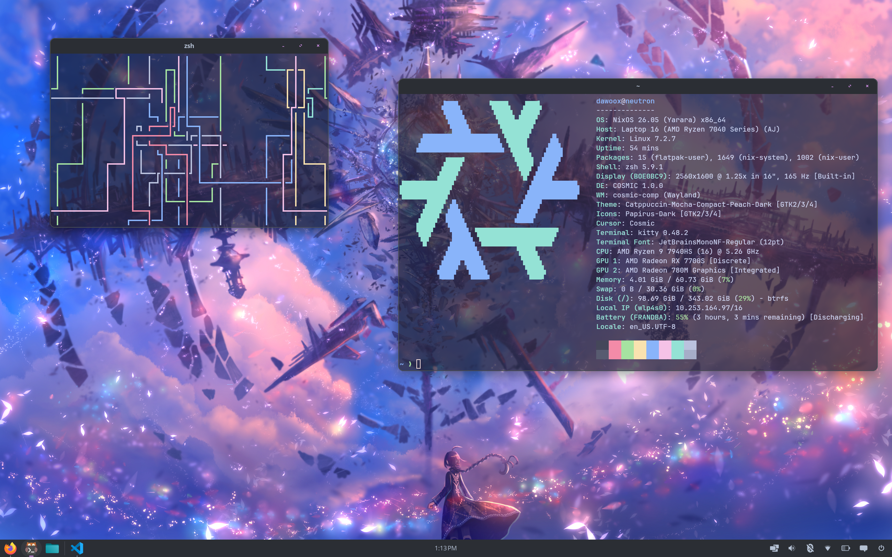

<div align="center">

# I use NixOS btw

</div>



## What is it, what's in it

This is my personnal NixOS configuration for my Framework 16 laptop.

## Hardware config

This flake is made to run on a Framework 16 with those specs:
 - AMD RX7700S dGPU
 - Ryzen 9 7940HS CPU
 - 64GB DDR5 RAM

You can easily adapt this configuration for other hardware by changing `nixos/hardware-configuration` and the nixos-hardware config in `flake.nix`.

## :snowflake: Usage

```nix
sudo nixos-rebuild switch --flake github:dawoox/nixos#neutron
```